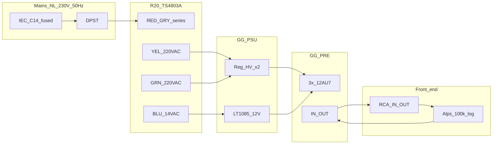
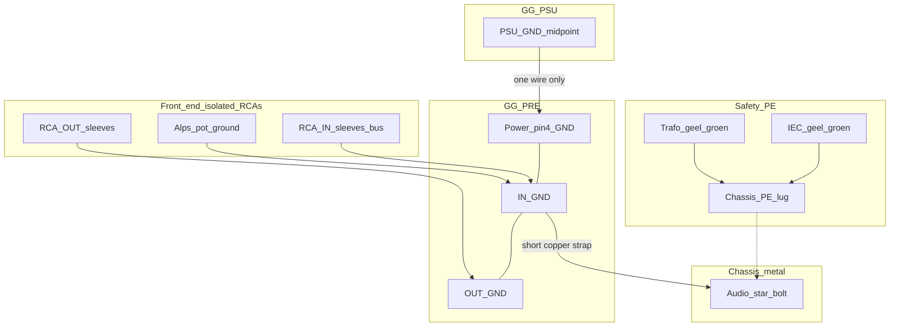

[← Project home](./README.md)

# Zero Zone GG kit — step-by-step build guide

**GZLOZONE GG-PSU + GG-PRE AMP** with **R20-TS4803A** transformer, **IEC** mains inlet, **Alps** volume control, and **RCA** I/O.

This is the **workshop document**: follow phases in order, check boxes, fill in **Measured** columns. Schematics and BOM live in linked files — do not skip them when a step says **measure first**.

| Deep references | Use when |
|-----------------|----------|
| [gg-psu/transformer.md](./gg-psu/transformer.md) | Primary/secondary colours, 230 V strapping |
| [gg-psu-schematic.md](./gg-psu-schematic.md) | ±200 V strap, PSU connectors |
| [gg-pre/README.md](./gg-pre/README.md) | Preamp terminals, tube layout |
| [marantz-7-vs-gg-reference.md §5](./marantz-7-vs-gg-reference.md#5-star-grounding-deep-dive) | Star ground theory and kit practice |

**Legend:** **C** = confirmed in project docs · **I** = inferred · **U** = you must measure on your hardware.

**Mains (this guide):** **Netherlands / EU — 230 V, 50 Hz** **C** (nominal wall supply). Wire the R20 primary **series** for 230 V (**RED ↔ GRY** tied); **50 Hz** needs no extra parts beyond a **250 VAC**-rated fuse and inlet.

---

## 0. How to use this guide

### 0.1 Phase order (do not skip)

| Phase | What | GG-PRE connected? | Tubes in? | Signal wired? |
|-------|------|-------------------|-----------|---------------|
| **0** | Parts, bench, mains hardware | — | — | No |
| **1** | Transformer / IEC | No | — | No |
| **2** | GG-PSU bring-up | No | — | No |
| **3** | GG-PRE power only | Yes (4 wires) | After rails OK **I** | No |
| **4** | RCA, pot, star ground | Yes | Yes | Yes |
| **5** | Listen / tune | Yes | Yes | Yes |
| **6** | Chassis (later) | Yes | Yes | Yes |

### 0.2 Stop if fail

- **Smoke**, **hissing arc**, or **hot smell** → power off, discharge HV caps, diagnose before retry.
- **±200 V** wrong by more than **~10%** or **unstable** → do not insert tubes; fix PSU strapping / zeners ([gg-psu-component-id.md](./gg-psu-component-id.md)).
- **Heater mode unknown** → do not apply **+12** until pins **4/5/9** are continuity-checked ([gg-pre-amp-schematic.md §3](./gg-pre-amp-schematic.md)).

### 0.3 Safety (every session)

- **±200 V** and **~220 VAC** secondaries can **kill**. Work one hand in pocket when probing **I**.
- **Discharge** PSU bulk caps before touching HV nodes ([gg-psu/README.md](./gg-psu/README.md)).
- **Primary fuse** in line; insulated terminations on all AC.

---

## Phase 0 — Parts, tools, bench layout

### 1.1 Core kit (you have — photos **C**)

- [ ] **R20-TS4803A** R-core transformer ([label photo](./pcb-photos/transformer/zerozone-r20-ts4803a-label.jpg))
- [ ] **GG-PSU** PCB (populated)
- [ ] **GG-PRE AMP** PCB (populated)
- [ ] **3× 12AU7** (ECC82)

### 1.2 Front end and mains (bench or chassis)

| Item | Suggested spec | Checked |
|------|----------------|---------|
| **IEC inlet** | C14, **with fuse holder** (see **Phase 1 §1.0 fuse**; interim **ESKA 1.6 A Träge**, order **200 mA T** e.g. **ESKA 522.520**) | [ ] |
| **Power switch** | **DPST** (double-pole single-throw), **≥ 250 VAC**, **≥ 2 A** **I** — switches **both L and N** to the trafo primary | [ ] |
| **Alps pot** | Dual-gang, **log taper (A)**, **100 kΩ** class (e.g. RK27) | [ ] |
| **RCA jacks** | 2× in, 2× out; isolated ground lug preferred | [ ] |
| **Star ground (chosen)** | Short **copper strap** (~25 mm wide): **`IN_GND`→★** ([§3](#3-star-grounding-do-with-phase-4--6-wiring)) | [ ] |
| **Star ground (debug)** | 2× **10 Ω, 0.5 W** (optional sleeve lift later) | [ ] |
| **Wire** | **18 AWG** AC; **22–24 AWG** signal; shielded cable for inputs | [ ] |
| **Barrier strip / Wago** | Trafo ↔ PSU AC connections | [ ] |

### 1.3 Tools

- [ ] DMM (AC and DC volts, continuity)
- [ ] Discharge tool or **high-value resistor** for HV caps **I**
- [ ] Variac or **series lamp** for first mains power-on **I** (recommended)
- [ ] Tube puller, labels for V1/V2/V3
- [ ] Headphones / amp at **low level** for Phase 5

### 1.4 Bench layout

- [ ] Trafo on mat; **GG-PSU** beside it; **GG-PRE** on standoffs (not bare metal table)
- [ ] **YEL / GRN / BLU** leads labelled
- [ ] Signal wiring kept away from trafo and bridges

**Phase 0 sign-off:** [ ] All parts staged · [ ] Bench layout · [ ] Trafo leads labelled.

---

## 2. System overview

### 2.1 Signal and power chain

```
IEC (fused) ──► DPST ──► R20-TS4803A (230 V: RED–GRY tie)
                    ├─ YEL + GRN ──► GG-PSU HV-IN
                    └─ BLU (14 VAC) ──► GG-PSU FIL-IN
                              │
                    GG-PSU ──┴── ±200 V, +12 V, GND ──► GG-PRE (4-pin)
                              │
RCA IN ──► Alps pot ──► IN terminal          OUT terminal ──► RCA OUT
```



### 2.2 GG-PRE screw terminals **C**

**Power** (right edge, **top → bottom**):

| Pin | Net | Wire from GG-PSU |
|-----|-----|------------------|
| 1 | **−200 V** | Negative regulated HV |
| 2 | **+12** | Filament DC |
| 3 | **+200 V** | Positive regulated HV |
| 4 | **GND** | Common (single feed from PSU reference) |

**Audio IN** (top centre): **IN-R** · **GND** · **IN-L** (left to right).

**Audio OUT** (bottom centre): **OUT-R** · **GND** · **OUT-L**.

### 2.3 Tube positions **I**

| Tube | Board location | Role |
|------|----------------|------|
| **V1** | Near **IN-R** | Right channel front end |
| **V2** | Near **IN-L** | Left channel front end |
| **V3** | Centre | Dual output cathode followers |

### 2.4 Transformer quick reference **C**

| Wire | Function |
|------|----------|
| **BLK – RED** | Primary half A (115 V) |
| **GRY – ORG** | Primary half B (115 V) |
| **230 V:** tie **RED + GRY** only; mains across **BLK** and **ORG** |
| **YEL** | HV secondary ~220 VAC |
| **GRN** | HV secondary ~220 VAC |
| **BLU** | Filament secondary ~14 VAC |

Full diagrams: [gg-psu/transformer.md](./gg-psu/transformer.md).

---

## 3. Star grounding (do with Phase 4 / 6 wiring)

Grounding is **part of the circuit** on grounded-grid stages ([§5](./marantz-7-vs-gg-reference.md#5-star-grounding-deep-dive)). Rectifier/HV return currents must **not** share a long path with **IN GND** before the star — otherwise hum modulates the **grounded-grid** stage.

**PCB local pour **C**:** power **`GND`**, **IN centre**, **OUT centre** share a ground spine on GG-PRE ([gg-pre-pcb-reverse-engineering.md](./gg-pre-pcb-reverse-engineering.md)) — that is **not** the **chassis** star until you wire it.

**As-built RCAs **C**:** plastic bodies — sleeves **isolated** from chassis (required for this plan).

### 3.1 Safety PE vs audio star

- **Geel-groen = PE (aarde)**, not neutral. Neutral is **blauw**.
- Existing safety bond (keep as-is):

```text
IEC PE (geel-groen) ──┐
trafo geel-groen ─────┴──► chassis PE lug (near IEC)
```

- That PE lug is **not** the audio star. Chassis metal still connects PE to the audio star electrically (Class I — intended). Avoid **extra intentional circuit-to-chassis wires**.

### 3.2 Chosen method (this build)

**Method B — one copper strap:** **GG-PRE `IN_GND`** (same net as power pin 4 / `OUT GND` pour) → **chassis audio star bolt** near the **input / GG-PRE** side (prefer input side over pure geometric middle; middle OK only if leads stay short).

**Only one intentional circuit conductor** lands on the star bolt — from **`IN_GND`**. Everything else gathers at **`IN_GND` / the board** first.

Keep **10 Ω sleeve→chassis** (Method A) as a **hum-debug swap later**, not the first wiring ([reference §5.2](./marantz-7-vs-gg-reference.md#52-what-bruce-rozenblit--kit-notes-recommend-two-equivalent-methods)).

### 3.3 What lands on the star bolt

| From | Lands on star bolt? | Goes where instead |
|------|---------------------|--------------------|
| **GG-PRE `IN_GND`** | **Yes — the only audio wire/strap** | Short copper strap → ★ |
| **RCA IN sleeves** | **No** | → `IN_GND` terminal / bus |
| **Alps pot ground** | **No** | → same `IN_GND` bus |
| **RCA OUT sleeves** | **No** | → `OUT_GND` only |
| **PSU `GND`** | **No** | → PRE pin 4 only |
| **IEC PE / trafo shield** | **No** | Stay on PE lug |
| **Star bolt into chassis** | (mechanical) | Bare metal = the chassis bond |
| **Mains N / L** | **Never** | Inlet / switch / primary only |
| **Filament return** | **No separate chassis wire** | Stays on PSU→PRE `GND` after measure **U** |

### 3.4 Wiring diagram



```text
                    chassis metal
                         │
IEC PE + trafo GY ──► PE lug        ★ audio star bolt (bare metal)
                         │               ▲
                         └───────────────┘ (chassis only — no extra PE wire)

PSU GND ──── one wire ────► GG-PRE pin4 GND ═══ PCB pour ═══ IN GND ═══ OUT GND
                                              │                │           │
                                         copper strap     IN sleeves    OUT sleeves
                                              │            + pot GND     (to OUT GND
                                              ▼             only)         only)
                                         ★ star bolt
```

### 3.5 Rules (checklist)

- [ ] **One** circuit wire/strap to chassis star: **`IN_GND` → ★**
- [ ] **One** power ground wire: **PSU GND → GG-PRE pin 4 (`GND`)**
- [ ] **IN sleeves + pot ground → `IN_GND`** (not separate star radials)
- [ ] **OUT sleeves → `OUT_GND` only** (no second chassis bond at outputs)
- [ ] **PE** stays on its lug; no extra PE wire to the audio star
- [ ] Boards on **insulating standoffs** — no accidental PCB→chassis bonds via screws
- [ ] Do **not** add a separate PSU “GND to chassis” tab once the PRE strap is fitted

### 3.6 Bench without metal chassis

- [ ] Use a **copper bus** as “fake chassis” at the star.
- [ ] **PSU GND → PRE pin 4 → IN GND / pot ground** at **one** lug.
- [ ] Optional **10 Ω** from RCA sleeves to that bus (debug only).

### 3.7 Before you bond — measure **U**

- [ ] Filament return vs HV return on **GG-PSU** may be isolated until user bonds ([gg-psu-pcb-reverse-engineering.md](./gg-psu-pcb-reverse-engineering.md)).

---

## Phase 1 — Transformer and mains

**Goal:** Fused IEC, **DPST** mains switch, correct **230 V** primary, labelled secondaries, no-load AC voltages. **GG-PSU disconnected** for first mains test.

### 1.0 IEC, fuse, and DPST (mains front end)

#### Fuse (primary, in **L** only)

| Property | Recommendation **I** | Why |
|----------|----------------------|-----|
| **Type** | **Time-delay / slow blow** (marking **T**, “delayed”, or anti-surge) | R-core **inrush** on turn-on; fast **F** fuses often nuisance-trip |
| **Current** | **200 mA** for **230 V** EU (first choice) | Label secondaries ≈ **30 VA** class → steady primary ≈ **130–180 mA**; **200 mA T** is headroom without being weak protection |
| **Alternate** | **160 mA T** if measured idle is low and **200 mA** feels loose; **250 mA T** only if **200 mA** trips on every cold start **and** wiring is verified | Re-tune from **measurement**, not guess |
| **Voltage** | **≥ 250 VAC** (mains-rated) | EU mains |
| **Package** | **5×20 mm** glass (match fused IEC module) | Typical C14 holder |
| **Breaking** | **HBC** / mains-rated part (e.g. Schurter, Littelfuse) | Not automotive; not DC-only |

**Rough check:** label load ≈ 2×(220 V×34 mA)+14 V×1 A ≈ **29 W** → \(I_\mathrm{primary} \approx 29/230 \approx 130\) mA at 100% load, plus loss → **~150–200 mA** steady at full crank. Idle with tubes is lower — a **200 mA T** fuse should **not** blow in normal use.

**After burn-in:** measure **true RMS** primary current at idle (and optionally at loud listen). Fuse rating ≈ **1.25–2×** steady **RMS**, still **T** type. If **200 mA T** blows only at switch-on → check inrush/wiring before upsizing.

**115 V US** (parallel primaries): same VA needs **~2×** current → about **400 mA T** **I** on 115 V.

**Interim fuse on bench:** **ESKA 1.6 A Träge** (5×20) is acceptable until **200 mA T** arrives; **do not** use **6.3 A T** or **4 A fast** on the primary. **Order target:** **ESKA 522.520** or equivalent **200 mA T**, 250 VAC, 5×20 mm.

#### Netherlands (230 V / 50 Hz) wire colours **C**

| Colour | Role (NEN 1010 / HD 60364) | To |
|--------|----------------------------|-----|
| **Bruin** | **Fase (L)** — switched / fused conductor **I** | **Fuse** → **DPST pole 1** → trafo **BLK** |
| **Blauw** | **Nul (N)** — return conductor | **DPST pole 2** → trafo **ORG** |
| **Geel-groen** | **Aarde (PE)** | Chassis **only** — **not** interchangeable with blauw |

**Are bruin and blauw “equal”?** Under **NEN 1010** they are **not** the same function: **L** and **N** are named, coloured, and terminated differently; **both** can be dangerous (230 V between them). What *is* true in NL:

- **Schuko (type F)** plugs are **unpolarized** — the wall cord may swap which conductor is **L** vs **N** at your **IEC** pins. You often cannot rely on “left wire = bruin” without checking the inlet markings or measuring.
- For an **isolated transformer primary** only (your **BLK–ORG** pair), **swapping bruin ↔ blauw** at the trafo terminals is usually **fine for AC operation** (no polarity requirement).
- **DPST** that opens **both** poles when OFF is normal good practice here — then neither wire feeds the trafo when off.
- **Fuse** (overcurrent protection) still belongs in the **fase (L)** path per installation rules — **not** because blauw is “safe”, but because a **blown neutral fuse with live still connected** is a serious fault condition. Use the inlet’s **L**-marked fuse position if present.

Verify **ELCOM** silk **L / N / ⏚** and your photos in [pcb-photos/build/](./pcb-photos/build/).

**Build photos (inlet + DPST WIP):** [overview](./pcb-photos/build/iec-dpst-wiring-overview.jpg) · [earth / line connections](./pcb-photos/build/iec-elcom-earth-and-lines.jpg).

#### As-built inlet wiring (user **C**, ELCOM + DPST, 2026-11-10)

Documented from your chassis photos and description (updated wire → trafo colours):

```
IEC blauw  ──► [NTC] ──► [fuse, 5×20] ──► DPST pole A ──► trafo **BLK** (zwart)
IEC bruin  ────────────────────────────► DPST pole B ──► trafo **ORG** (oranje)
IEC geel-groen (PE) ──┬──► chassis (safety earth bus)
trafo geel-groen  ────┘     same bonding point as IEC PE
```

**Inside trafo (230 V, unchanged):** tie **RED ↔ GRY**; primary is still **BLK … ORG** across the two 115 V halves ([transformer.md](./gg-psu/transformer.md)).

| Item | Status | Notes |
|------|--------|-------|
| **PE + trafo shield to one chassis point** | **OK** **C** | IEC PE and trafo **geel-groen** at the **same** lug — good; keeps one safety-earth reference |
| **DPST switches both colours** | **OK** **C** | Blauw and bruin through switch before **BLK** / **ORG** |
| **Blauw→BLK, bruin→ORG** | **OK** **C** | Valid AC primary assignment (Schuko may swap L/N at IEC; this is your fixed mapping) |
| **NTC on blauw leg** | **OK** **I** if rated | Series: **blauw → NTC → fuse → switch**; mains-class NTC; [photo](./pcb-photos/build/iec-elcom-earth-and-lines.jpg) |
| **Fuse only in blauw chain** | **Acceptable interim / not ideal** | **NEN** prefers fuse in **bruin (L)**. If blauw fuse blows **with switch ON**, bruin still feeds **ORG** → **switch OFF** before fuse change; later: move fuse to bruin if inlet allows |
| **Audio star** | **Separate** **I** | This chassis PE bus is **safety earth** only until Phase 4 audio star (do not tie RCA ground to PE at multiple random points) |

**Verdict:** **OK to proceed** to Phase 1 no-load trafo test when checks below pass.

| Check | Done |
|-------|------|
| Switch **OFF**, unplugged: **no** continuity blauw→**BLK** **and** bruin→**ORG** | [ ] |
| Switch **ON**, unplugged: continuity **both** paths | [ ] |
| **RED–GRY** tied at trafo only (no BLK/ORG cross-ties) | [ ] |
| Trafo **geel-groen** and IEC PE same chassis point; **not** on switch poles | [ ] |
| Order on blauw: **NTC → fuse → switch → BLK** | [ ] |
| Fuse: **ESKA 1.6 A Träge** (interim) or **200 mA T** when available | [ ] |

**Optional improvement (later):** **bruin → fuse → switch → ORG**, **blauw → NTC → switch → BLK** — only if you want fuse on bruin; keep **NTC** on one leg only.

#### DPST wiring (reference target)

Use a **DPST** so **both** line and neutral to the transformer open when the amp is off (safer on the bench than switching **L** only).

```
IEC pin L  ──► [ fuse 200 mA T, 250 VAC ] ──► DPST pole 1 ──► BLK   (trafo primary)
IEC pin N  ──────────────────────────────► DPST pole 2 ──► ORG   (trafo primary)
IEC pin PE (earth) ─────────────────────► chassis / bench safety ground
                                              (NOT through switch)
```

| Step | Check |
|------|-------|
| Fuse in **L** only **I** | [ ] After inlet, before switch |
| **OFF** = no continuity L→BLK and N→ORG | [ ] DMM ohms, unplugged |
| **ON** = continuity both poles | [ ] |
| **PE** never on switch poles | [ ] |
| Switch body clearance from metal chassis **I** | [ ] Use insulated bat handle or guard |

If the IEC module has its **own** switch, you may still add a **DPST** after the fuse for the trafo feed — avoid **two** switches in series on **L** only with **N** always connected (**I**).

### 1.1 Primary wiring (230 V)

Inside the trafo (after BLK / ORG):

```
   BLK ────── (from DPST pole 1)
                    ├── winding A (115 V)
                 RED ─┬─ GRY
                        ├── winding B (115 V)
   ORG ────── (from DPST pole 2)
```

- [ ] **1.1.1** Tie **RED** to **GRY** only (no other cross-ties).
- [ ] **1.1.2** **DPST ON:** **BLK** and **ORG** fed from IEC **L** (fused) and **N** as in §1.0.
- [ ] **1.1.3** IEC **earth (PE)** → bench/chassis safety ground (not audio star yet).

### 1.2 Secondaries to terminals (PSU still off)

- [ ] **1.2.1** **YEL** and **GRN** to barrier strip → will go to **HV-IN** in Phase 2.
- [ ] **1.2.2** **BLU** to barrier strip → will go to **FIL-IN** in Phase 2.
- [ ] **1.2.3** Insulate all HV secondary ends.

### 1.3 Resistance checks (power off)

| Test | Expected | Measured |
|------|----------|----------|
| Primary BLK–ORG (via series windings) | Low ohms, not short to core | |
| YEL–GRN (if both ends open) | High / open between windings **U** | |
| BLU to any primary | No continuity to mains | |

### 1.4 No-load AC test (PSU disconnected)

- [ ] **1.4.1** Power on briefly; measure AC:
- [ ] **1.4.2** Power off; record:

| Winding | Expected (approx.) | Measured |
|---------|-------------------|----------|
| **YEL**–ref **I** | ~220 VAC class | |
| **GRN**–ref **I** | ~220 VAC class | |
| **BLU**–ref | ~14 VAC | |

**Phase 1 sign-off:** [ ] RED–GRY correct · [ ] Fuse in L · [ ] **DPST opens L+N** when OFF · [ ] Secondaries labelled · [ ] Voltages sane.

---

## Phase 2 — GG-PSU (preamp disconnected)

**References:** [gg-psu/README.md](./gg-psu/README.md), [gg-psu-schematic.md §2](./gg-psu-schematic.md), [gg-psu-component-id.md](./gg-psu-component-id.md).

### 2.1 Visual pre-flight

- [ ] **2.1.1** 3× **KBP307** bridges oriented correctly.
- [ ] **2.1.2** **2SK2700** on heatsinks, tight.
- [ ] **2.1.3** D-V / **CR1** strapping: **200 V** zener + short per BOM freeze.
- [ ] **2.1.4** Electrolytic polarity correct (see photos in [pcb-photos/psu/](./pcb-photos/psu/)).

### 2.2 Connect transformer to PSU

- [ ] **2.2.1** **YEL** → one **HV-IN** pair; **GRN** → other **HV-IN** pair (**pin order U** — buzz or note which is which).
- [ ] **2.2.2** **BLU** → **FIL-IN** / filament AC input (2-pin block near filament / **LT1085** — not mains).

**As-built trafo → GG-PSU (user **C**, not powered yet):** [photo](./pcb-photos/build/trafo-psu-wired-not-powered.jpg)

| PSU connector | Your wiring (verify before power) |
|---------------|-------------------------------------|
| **4-pin AC-IN / HV-IN** (bottom centre) | **Groen** pair → top two screws; **geel** pair → bottom two screws (= **GRN** + **YEL** 220 V windings per trafo label) |
| **2-pin** (top/near filament reg) | **Blauw** twisted pair → toward trafo (must be **14 V BLU** secondary only — **not** mains blauw) |
| **GG-PRE** | **Not** connected yet **I** |

| Before first power | |
|--------------------|---|
| [ ] **RED–GRY** tied; mains only on **BLK** / **ORG** via switch | |
| [ ] Loose trafo lead(s) at bottom — if **BLU 14 V**, land on **2-pin** filament AC; do not leave floating | |
| [ ] **No** continuity from **HV-IN** screws to **primary** BLK/ORG | |
| [ ] **GG-PRE** 4-pin **unwired** | |
| [ ] Fuse installed; switch test **OFF** / **ON** | |

**HV-IN pin map (fill in):**

| PSU pin label | Connected to |
|---------------|--------------|
| HV-IN 1 (top) | **GRN** wire (groen) |
| HV-IN 2 | **GRN** wire (groen) |
| HV-IN 3 | **YEL** wire (geel) |
| HV-IN 4 (bottom) | **YEL** wire (geel) |
| FIL-IN (2-pin) | **BLU** 14 V **I** — confirm pair is only filament winding |

### 2.3 First energize

- [ ] **2.3.1** Variac/lamp **I** or brief on/off.
- [ ] **2.3.2** Filament LED / indicator if present.
- [ ] **2.3.3** No smoke; MOSFET sinks warm only after minutes.

### 2.4 Filament rail (tubes still out of preamp)

- [ ] **2.4.1** Adjust **W202** trimmer toward **~12.6 V DC** at filament output **I** (final value after Phase 3 heater check).

| Setting | Expected | Measured |
|---------|----------|----------|
| Filament DC out | 12.0–12.6 V **I** | |

### 2.5 High voltage ± strap (silk-accurate — easy to get wrong)

**Your board **C**:** one **4-screw** block = two **VDC-OUT** pairs (`−` `+` `−` `+` top→bottom); filament **HR-X** (`−` `+`). Photo: [04-overview-vdc-out.jpg](./pcb-photos/psu/04-overview-vdc-out.jpg). Deep ref: [gg-psu-schematic.md §2](./gg-psu-schematic.md).

Each VDC-OUT pair is a **floating ~+200 V** supply (`−` → `+`). For bipolar rails you **series** them around a **midpoint = GND**:

- Upper channel sits **above** ground → its **`+`** = **+200 V**, its **`−`** = **GND**
- Lower channel sits **below** ground → its **`+`** = **GND**, its **`−`** = **−200 V**
- **Do not** wire “all minuses to ground.”

#### Mapping table (PSU → GG-PRE) + meter checks

Join **top `−`**, **bottom `+`**, and **HR-X `−`** at the PSU (short jumpers), then **one** wire to PRE **`GND`**.

| PSU screw (silk) | → GG-PRE pin | Measure (DMM + on this node, − on **GND** midpoint) | Expected | Measured |
|------------------|--------------|------------------------------------------------------|----------|----------|
| **Top VDC-OUT `+`** | **`+200V`** | vs GND | **~+200 V DC** | |
| **Top VDC-OUT `−`** | **`GND`** (midpoint) | — | 0 V ref | |
| **Bottom VDC-OUT `+`** | **`GND`** (same midpoint) | Continuity to top `−` (power off) | **~0 Ω** after jumper | |
| **Bottom VDC-OUT `−`** | **`−200V`** | vs GND | **~−200 V DC** | |
| **HR-X `+`** | **`+12`** | vs GND | **~+12.0–12.6 V DC** | |
| **HR-X `−`** | **`GND`** (same midpoint) | Continuity to HV GND jumpers (power off) | **~0 Ω** after bond | |

| Extra check | Expected | Measured |
|-------------|----------|----------|
| **Top `+`** vs **bottom `−`** (across both rails) | **~400 V DC** | |
| **Top `+`** vs **top `−`** (one channel alone, before or after strap) | **~+200 V** | |
| **Bottom `+`** vs **bottom `−`** (other channel alone) | **~+200 V** | |

```text
Top VDC-OUT + ──────────────────────────► PRE +200V

Top VDC-OUT − ──┐
Bottom VDC-OUT + ─┼── (join at PSU) ───► PRE GND   ← one wire only
HR-X − ───────────┘

Bottom VDC-OUT − ───────────────────────► PRE −200V

HR-X + ─────────────────────────────────► PRE +12
```

**You may swap** which physical pair is the “+200” channel and which is the “−200” channel; the rule stays: **one channel’s `−` and the other channel’s `+` form GND.**

- [ ] **2.5.1** Jumper top `−` ↔ bottom `+` ↔ HR-X `−`; mark that node as **PSU GND**.
- [ ] **2.5.2** Wire four leads to PRE: **+200**, **−200**, **+12**, **GND** (GND = the joined node only).
- [ ] **2.5.3** Fill **Measured** columns above (**tubes out** / PRE unwired for first HV check if preferred).
- [ ] **2.5.4** Confirm **no** wire from bottom `−` or top `+` into the GND bundle.

### 2.6 Ground reference before preamp wire

- [ ] **2.6.1** PSU GND = joined midpoint in **§2.5** ([reference §5.4](./marantz-7-vs-gg-reference.md#54-gg-psu-grounding--extra-caution-u)).
- [ ] **2.6.2** **One** wire PSU **GND** → GG-PRE pin **4** — not multiple parallel ground paths; not to chassis star (star is `IN_GND`→★ later).
- [ ] **2.6.3** **Measure** filament return vs HV return on PSU (**U**) before bonding pot/RCA to chassis ([gg-psu-pcb-reverse-engineering.md](./gg-psu-pcb-reverse-engineering.md)).
- [ ] **2.6.4** **GND is midpoint** for ±200 V — symmetry matters for cathode followers ([reference §5.6](./marantz-7-vs-gg-reference.md#56-marantz-model-7-vs-gg-grounding-philosophy)).

### 2.7 Thermal soak (15–30 min, no preamp)

- [ ] Re-measure rails; heatsinks warm, not untouchable.

**Phase 2 sign-off:** [ ] FIL V set · [ ] ±200 V OK · [ ] HV-IN map written · [ ] GND tie point chosen.

---

## Phase 3 — GG-PRE power (no audio wiring)

**References:** [gg-pre/README.md](./gg-pre/README.md), [gg-pre-amp-schematic.md](./gg-pre-amp-schematic.md).

### 3.1 Heater wiring — **measure before power**

With board **unpowered**, each socket:

| Socket | Pin 4 → | Pin 5 → | Pin 9 → | +12 terminal | GND terminal |
|--------|---------|---------|---------|--------------|--------------|
| V1 | | | | | |
| V2 | | | | | |
| V3 | | | | | |

- [ ] **3.1.1** Document **series 12.6 V** (4–5 string) vs **parallel 6.3 V** — do not guess.
- [ ] **3.1.2** Set PSU **W202** to match.

### 3.2 Four-wire power cable

Use adequately insulated wire; keep leads short; twist pairs **I** if long.

| GG-PRE pin (top→bottom) | PSU connection |
|-------------------------|----------------|
| **−200 V** | PSU −200 V |
| **+12** | Filament + |
| **+200 V** | PSU +200 V |
| **GND** | **One** PSU GND reference |

- [ ] **3.2.1** Double-check pin order on silkscreen before tightening.
- [ ] **3.2.2** Use **twisted pair or coax** for long inter-board runs ([reference §5.3](./marantz-7-vs-gg-reference.md#53-what-your-gg-pre-pcb-already-does-c)).

### 3.3 Tubes out — rail test

- [ ] **3.3.1** Power on; measure at **GG-PRE** terminal block:

| Terminal | Expected | Measured |
|----------|----------|----------|
| −200 V | ~−200 V | |
| +12 | per heater mode | |
| +200 V | ~+200 V | |

### 3.4 Insert tubes

- [ ] **3.4.1** Power off; insert **V1, V2, V3** (correct orientation).
- [ ] **3.4.2** Power on; heaters glow evenly.
- [ ] **3.4.3** Re-check rails; listen for abnormal hiss.
- [ ] **3.4.4** Optional: DMM on **OUT** terminals — large DC offset is **U** until tubes settle (AC-coupled outputs).

**Phase 3 sign-off:** [ ] Heater mode documented · [ ] Rails at terminal · [ ] Tubes OK.

---

## Phase 4 — RCA, Alps pot, star ground

**Full star rules and diagrams:** [§3](#3-star-grounding-do-with-phase-4--6-wiring). **Star location:** prefer **input / GG-PRE** side. Plastic isolated RCAs **C**.

### 4.1 Alps pot wiring (100 kΩ log dual gang **I**)

Typical lug names vary by part; use your datasheet. Logical connections:

| From | To |
|------|-----|
| **RCA IN L** centre | Pot **L** input (top of track) |
| **RCA IN R** centre | Pot **R** input |
| Pot **L** wiper | **IN-L** |
| Pot **R** wiper | **IN-R** |
| Pot ground end(s) / CCW | **IN GND** (with RCA return bus) |
| **RCA IN** sleeves | Audio ground bus → **IN GND** |

- [ ] **4.1.1** Pot at minimum: wiper near ground side; verify with ohmmeter **I**.
- [ ] **4.1.2** RCA **sleeves:** return to **IN GND** at board — **not** to chassis except via the single `IN_GND` strap ([§3.2](#32-chosen-method-this-build)).

### 4.2 Output RCAs

| From | To |
|------|-----|
| **OUT-L** | RCA OUT L centre |
| **OUT-R** | RCA OUT R centre |
| **OUT GND** | Output sleeves → **`OUT_GND` only** (board pour joins IN/OUT/power GND) |

- [ ] **4.2.1** Do **not** add a second chassis bond at the output jacks.

### 4.3 Signal ASCII (stereo)

```
RCA_IN_L/R (centre) ──► pot inputs
RCA IN sleeves + pot ground ──► IN GND
Pot wipers ──► IN-L, IN-R
OUT-L, OUT-R ──► RCA out centres
OUT sleeves ──► OUT GND only
IN GND ──► one copper strap ──► ★ chassis star bolt
```

### 4.4 Star bond (this build = Method B)

- [ ] **4.4.1** Confirm plastic RCA bodies isolate sleeves from chassis.
- [ ] **4.4.2** Wire **IN sleeves + pot ground → `IN_GND`**.
- [ ] **4.4.3** Wire **OUT sleeves → `OUT_GND`** only.
- [ ] **4.4.4** Fit **one** copper strap: **`IN_GND` → ★** star bolt (bare chassis metal).
- [ ] **4.4.5** Confirm **no** extra circuit→chassis wires (no PSU GND tab, no OUT-to-chassis).
- [ ] **4.4.6** (Debug later only) Method A: **10 Ω** IN sleeve→chassis — change one thing at a time ([§5.3](#53-hum-debug-if-needed)).

### 4.5 Keep leads short on bench

- [ ] First listen wiring **&lt; 30 cm** where practical.

**Phase 4 sign-off:** [ ] L/R labelled · [ ] Star = Method B / `IN_GND`→★ · [ ] Pot smooth mechanically.

---

## Phase 5 — Test and tune

### 5.1 Shorted inputs

- [ ] Short **RCA inputs** (plugs or pot at minimum with short **I**).
- [ ] Listen at moderate volume on line out → note hum/hiss level: __________

### 5.2 Line source

- [ ] **One** grounded source (avoid PC + double chassis ties).
- [ ] Pot starts **~9 o’clock**; increase slowly.
- [ ] Swap L/R cables to confirm channel labels.

### 5.3 Hum debug (if needed)

| Try | Done |
|-----|------|
| Rotate trafo 90° | [ ] |
| Increase distance PSU ↔ PRE | [ ] |
| Remove extra ground bonds | [ ] |
| Compare 10 Ω vs strap | [ ] |

### 5.4 Record final settings

| Item | Value |
|------|-------|
| W202 / filament V at PRE pin 2 | |
| +200 V at PRE | |
| −200 V at PRE | |
| HV-IN pin map (Phase 2) | |
| Star location / method (10 Ω vs strap) | |
| Fuse type in use | |
| Idle hum subjective (1–5 quiet) | |

### 5.5 Thermal soak

- [ ] Idle **15–30 min**; re-check PSU heatsinks and trafo temperature.

**Phase 5 sign-off:** [ ] Both channels · [ ] Acceptable idle noise · [ ] Settings logged in **§11**.

Aligns with [reference §5.7](./marantz-7-vs-gg-reference.md#57-suggested-bring-up-order-gg-pair-in-a-chassis).

---

## Phase 6 — Chassis (when you leave the bench)

- [ ] Mount **IEC**, **DPST** (often rear with inlet), **RCA**, **pot**; trafo away from input jacks.
- [ ] **Earth:** IEC PE + trafo geel-groen → PE lug ([§1.0](#10-iec-fuse-and-dpst-mains-front-end)); **audio** = one strap `IN_GND`→★ ([§3](#3-star-grounding-do-with-phase-4--6-wiring)).
- [ ] Star bolt near **input / GG-PRE**; boards on **insulating standoffs**.
- [ ] GG-PSU airflow to **N-MOS** heatsinks; AC strain relief.

Details: [marantz-7-vs-gg-reference.md §5.7](./marantz-7-vs-gg-reference.md#57-suggested-bring-up-order-gg-pair-in-a-chassis).

---

## 10. Sign-off matrix

| Step | Pass criterion | Date | OK |
|------|----------------|------|-----|
| Trafo | RED–GRY; fused primary; secondary volts | | [ ] |
| PSU alone | ~12–12.6 V FIL; ±200 V; stable heat | | [ ] |
| Heater mode | 4/5/9 documented | | [ ] |
| Preamp power | Tubes; rails at terminal | | [ ] |
| Star ground | One PSU→PRE GND; one chassis bond | | [ ] |
| Signal | L/R; pot; shorted-input hum OK | | [ ] |

---

## 11. Build log (fill in as you go)

| Date | Phase | Notes |
|------|-------|-------|
| 2026-11-10 | 0–1 | **As-built:** blauw→NTC→fuse→SW→**BLK**; bruin→SW→**ORG**; IEC PE + trafo geel-groen → chassis (same point); fuse-on-blauw interim — Phase 1 §1.0 |
| 2026-11-10 | 2 | Trafo→PSU wired, **not powered** — groen/geel→4-pin HV; blauw→2-pin **I**; photo [trafo-psu-wired-not-powered.jpg](./pcb-photos/build/trafo-psu-wired-not-powered.jpg) |
| 2026-11-11 | 3–4 | Star plan locked: plastic isolated RCAs; **Method B** one strap **`IN_GND`→★**; PE lug separate; see [§3](#3-star-grounding-do-with-phase-4--6-wiring) |
| 2026-11-11 | 2 | VDC-OUT / HR-X → PRE map + meter table locked in [§2.5](#25-high-voltage--strap-silk-accurate--easy-to-get-wrong) (top `+`→+200; bottom `−`→−200; top `−`+bottom `+`+HR-X `−`→GND) |
| | 1 | Trafo no-load: YEL ____ V, GRN ____ V, BLU ____ V |
| | 2 | HV-IN map; +200 ____ V; −200 ____ V; FIL ____ V |
| | 3 | Heater: series / parallel; tube bring-up |
| | 4 | Pot P/N ______; star: Method B / `IN_GND`→★ location ______ |
| | 5 | Hum / music listen |
| | 6 | Chassis |

---

## Known unknowns (close during build)

| Topic | Where to resolve |
|-------|------------------|
| HV-IN pin order | Phase 2 table; [gg-psu-schematic.md](./gg-psu-schematic.md) |
| Heater series vs parallel | Phase 3 table; [gg-pre-amp-schematic.md §3](./gg-pre-amp-schematic.md) |
| Filament vs HV return bond | DMM on PSU; [gg-psu-pcb-reverse-engineering.md](./gg-psu-pcb-reverse-engineering.md) |

---

[← Project home](./README.md) · [GG-PSU](./gg-psu/README.md) · [GG-PRE](./gg-pre/README.md)
