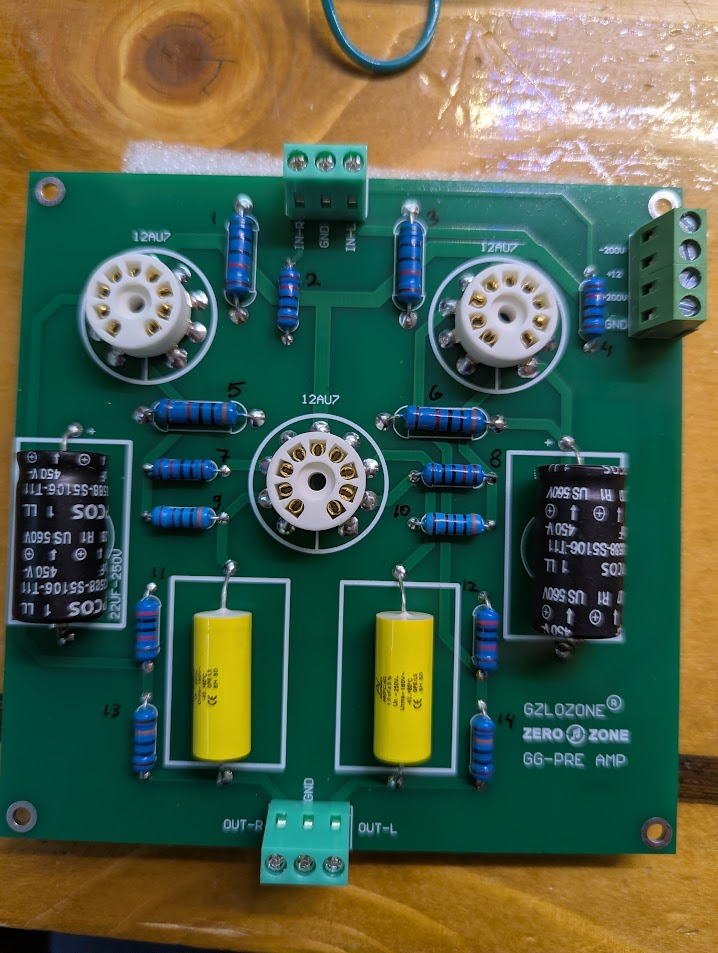

[← GG-PRE index](./gg-pre/README.md) · [Project](./README.md)

# GG-PRE AMP — Component ID

Sources: close-ups in `pcb-photos/closeups/`; resistor numbering photo (user-measured values, 2026-11-09).

All resistors: blue 5-band metal film, **1%** (brown tolerance band) unless noted.

**Wattage column:** estimated from body length/diameter on the board vs neighbors (not from body print). Chinese kits often use **~2 W** for the fatter/longest HV plate loads and **~1 W** for the standard blue bodies. Treat as rebuild guidance; verify part marking if available.

## Resistor reference photo (R1–R14)

Ink numbers on the component side match the table below.

Download / path: [component-side-resistors-numbered.jpg](./pcb-photos/component-side-resistors-numbered.jpg)

---

## Resistor BOM (R1–R14) — confirmed values

Layout on component side (matches user ink numbers):

| Ref | Ω | Est. power | Size (visual) | Board region |
|-----|---|------------|---------------|--------------|
| **R1** | 50 k | **~2 W** | Large (fat body, long) | Top, near V1 / IN-R side |
| **R2** | 10 k | **~1 W** | Standard | Top center, near input block |
| **R3** | 50 k | **~2 W** | Large | Top, near V2 / power side |
| **R4** | 10 k | **~1 W** | Standard | Top right, near power terminal |
| **R5** | 30 k | **~2 W** | Large / long horizontal | Mid, left of V3 |
| **R6** | 30 k | **~2 W** | Large / long horizontal | Mid, right of V3 |
| **R7** | 10 k | **~1 W** | Standard | Mid, below R5 |
| **R8** | 10 k | **~1 W** | Standard | Mid, below R6 |
| **R9** | 3 k | **~1 W** | Standard | Mid, below R7 |
| **R10** | 3 k | **~1 W** | Standard | Mid, below R8 |
| **R11** | 20 k | **~1 W** | Standard (tall mount) | Lower, above Cout-R |
| **R12** | 20 k | **~1 W** | Standard (tall mount) | Lower, above Cout-L |
| **R13** | 100 k | **~1 W** | Standard vertical | Bottom left / OUT-R string |
| **R14** | 100 k | **~1 W** | Standard vertical | Bottom right / OUT-L string |

### Value summary (qty)

| Value | Qty | Refs |
|-------|-----|------|
| 50 kΩ | 2 | R1, R3 |
| 30 kΩ | 2 | R5, R6 |
| 20 kΩ | 2 | R11, R12 |
| 10 kΩ | 4 | R2, R4, R7, R8 |
| 3 kΩ | 2 | R9, R10 |
| 100 kΩ | 2 | R13, R14 |

Stereo symmetry: each value appears in an L/R pair except the shared mid column (R5–R10 are paired L/R).

### Wattage sizing notes

| Visual class | Typical body on this PCB | Refs | Typical use on ±200 V GG stages (**I**) |
|--------------|--------------------------|------|----------------------------------------|
| **~2 W** | Noticeably thicker/longer than the small blues; similar scale to socket ceramic ring | R1, R3, R5, R6 | Plate / HV anode loads (higher dissipation) |
| **~1 W** | “Normal” blue metal-film axial (most of the board) | R2, R4, R7–R14 | Grid leaks, cathode bias, feedback, input series |

Dissipation on ±200 V depends on actual bias (measure on a built unit). If a 1 W part runs hot, step up to 2 W of the same value.

---

## Capacitors (confirmed from body print)

| Ref | Location | Installed | Silk | Conf |
|-----|----------|-----------|------|------|
| CoutR | Bottom-left / OUT-R | **ARCOTRONICS MKP C.4G · 1.0 µF ±5% · Un 250 V~** | outline | **C** |
| CoutL | Bottom-right / OUT-L | Same as CoutR | outline | **C** |
| Cdec (left) | Mid-left | **EPCOS B43588-S5106-T… · 10 µF · 450 V** | `22UF-250V` | **C** |
| Cdec (right) | Mid-right | Same / 10 µF 450 V | `22UF-250V` | **C** |

---

## Superseded photo-only guesses

Earlier band reads (300 kΩ, 300 Ω, 1 kΩ, 120 Ω / 12 kΩ conflicts) are replaced by the **R1–R14 table above** where they differ.

---

## Still useful to meter

1. Heater wiring: pins 4/5/9 ↔ `+12` / `GND` (series vs parallel).
2. Which electrolytic `+` pad ties to `+200V` vs `-200V`.
3. Buzz-out: map each R1–R14 to exact tube pin / net (topology still **I**).

---

## Close-up photo index

| File | Region |
|------|--------|
| `closeups/01-electrolytic-epcos.jpg` | Right HV electrolytic + nearby R |
| `closeups/02-brand-out-area.jpg` | Brand + mid resistors |
| `closeups/03-out-l-film.jpg` | CoutL |
| `closeups/04-out-l-resistors.jpg` | OUT-L resistor pair |
| `closeups/05-center-v3-resistors.jpg` | Center stack |
| `closeups/06-input-terminal.jpg` | Input terminal |
| `closeups/07-sockets-center.jpg` | V1/V3 sockets |
| `closeups/08-out-r-area.jpg` | OUT-R area |

---

[← GG-PRE index](./gg-pre/README.md) · [Project](./README.md)
