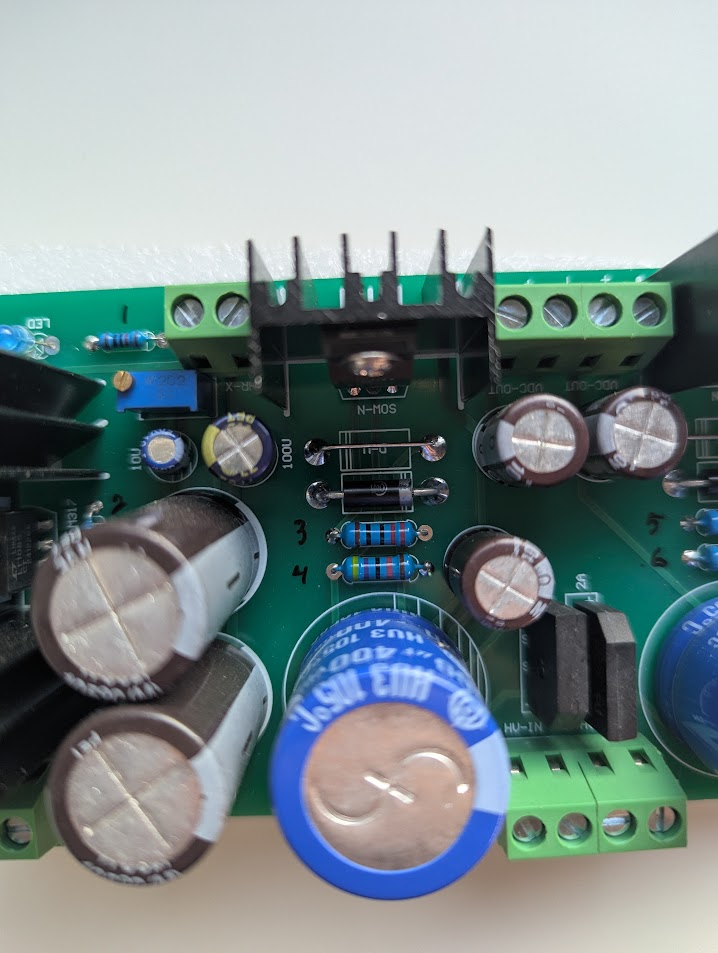
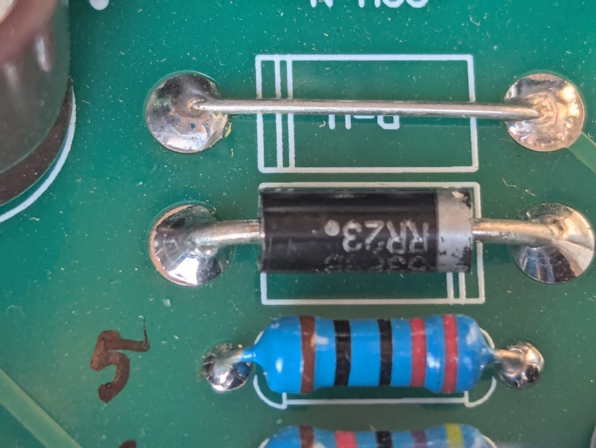
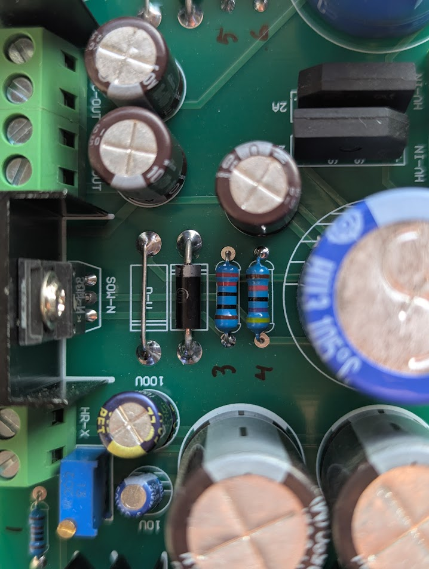
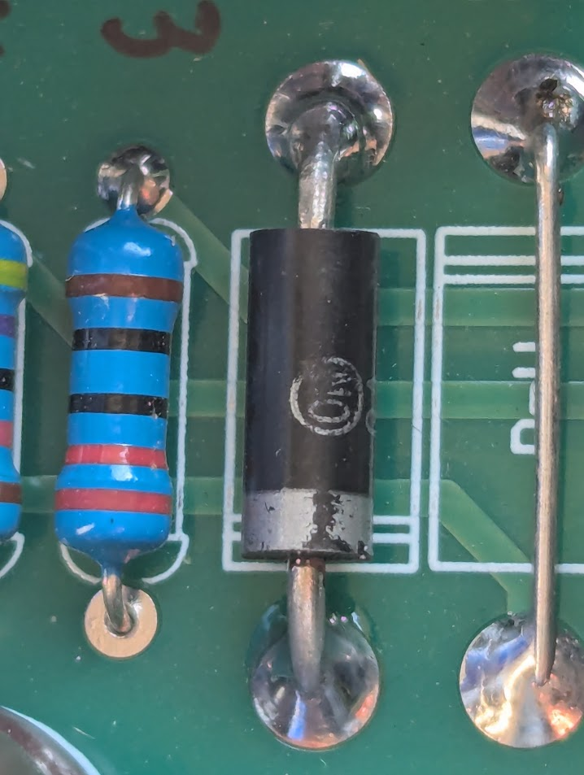

[← GG-PSU index](./gg-psu/README.md) · [Project](./README.md)

# GG-PSU — Component ID

Sources: [pcb-photos/psu/](./pcb-photos/psu/); user-confirmed **2026-11-09** (parts + **R1–R6**).

**Confidence:** **C** = user read or part marking · **I** = logical rail assignment (not continuity-proven) · **U** = still unknown.

---

## Semiconductors (confirmed)

| Ref | Qty | Part | Role | Conf |
|-----|-----|------|------|------|
| **Q1, Q2** | 2 | **2SK2700** (marking **K2700**, suffix **8S** on your parts) | N-ch HV series pass, heatsinked | **C** |
| **U1** | 1 | **LT1085CT** (date/lot **241228**) | Adjustable filament / LV regulator | **C** |
| **BR1, BR2** | 2 | **KBP307** | HV AC → DC (3 A, 1000 V class bridge) | **C** |
| **BR3** | 1 | **KBP307** | Filament (or auxiliary) AC → DC | **C** qty / **I** role |
| **D-V R (D-11)** | 1 | **wire short** | Right channel — [closeup](./pcb-photos/psu/closeups/diode-d11-rr23-r5-area.jpg) | **C** |
| **D-V R (other)** | 1 | **U** | Right channel — second D-V site not in photos yet | **U** |
| **D-V L (one site)** | 1 | **wire short** | Left channel — jumper beside **R3/R4** stack | **C** |
| **CR1** | 1 | **U** (Onsemi-style logo) | Left D-V / ref diode beside jumper — not **RR23** print; silk **CR1** **C** | **I** zener? |
| **D1** | 1 | **RR23** (?) | Separate from **CR1** footprint — may sit below **R3** on left **I** | **I** |
| **D2** | 1 | **RR23** | DMM **0.577 V** fwd, **OL** rev; marking **RR23** · **35** (batch?) **C** | **C** |
| **LED1** | 1 | Blue LED | Power / filament indicator | **C** |

Silkscreen **2A** near bridges is a generic label; installed bridges are **KBP307** (**3 A** class) **C**.

---

## Capacitors (confirmed values)

| Ref | Qty | Value | Est. assignment | Conf |
|-----|-----|-------|-----------------|------|
| **C1, C2** | 2 | **100 µF / 400 V** | Large blue — HV bulk, one per channel | **C** / **I** rail |
| **C3–C6** | 4 | **10 µF / 400 V** | Smaller brown — HV filter / local (2 per channel **I**) | **C** / **I** rail |
| **C7, C8** | 2 | **4700 µF / 25 V** | Large brown — LV rectifier reservoir | **C** / **I** rail |
| **C9** | 1 | **100 µF / 50 V** | Dark blue — regulator output or LV filter | **C** / **I** rail |
| **C10** | 1 | **10 µF / 50 V** | Small blue — input/adj bypass near **U1** | **C** |

### Value summary (qty)

| Value | Qty | Refs (assigned) |
|-------|-----|-----------------|
| 100 µF / 400 V | 2 | C1, C2 |
| 10 µF / 400 V | 4 | C3–C6 |
| 4700 µF / 25 V | 2 | C7, C8 |
| 100 µF / 50 V | 1 | C9 |
| 10 µF / 50 V | 1 | C10 |

**Note:** Photo mis-read **680 µF** on one blue cap earlier; your board uses **100 µF / 400 V** **C**.

---

## Potentiometer

| Ref | Qty | Value | Notes | Conf |
|-----|-----|-------|-------|------|
| **VR1** | 1 | **2 kΩ** multi-turn (**W202**, top line **13**) | Filament voltage adjust (**U1** ADJ network) | **C** |

No second trimmer reported on your unit — HV fine-trim may be zener-only or a fixed divider **I**.

---

## Resistor reference photos (R1–R6)

Ink numbers on the component side match the table below.

HV channel pairs **R3–R6**: [hv-channel-resistors-3-6-closeup.jpg](./pcb-photos/psu/hv-channel-resistors-3-6-closeup.jpg)

**D-11 jumper + RR23 (D2) + R5 area:** [closeups/diode-d11-rr23-r5-area.jpg](./pcb-photos/psu/closeups/diode-d11-rr23-r5-area.jpg)

**Left channel — D-V jumper, axial diode, R3/R4:** [closeups/d-v-left-d1-r3-r4-area.jpg](./pcb-photos/psu/closeups/d-v-left-d1-r3-r4-area.jpg)

**CR1 body + adjacent jumper (left):** [closeups/cr1-d-v-left-jumper.jpg](./pcb-photos/psu/closeups/cr1-d-v-left-jumper.jpg)

All listed parts: blue **5-band** metal film, **1%** (brown tolerance) unless noted.

---

## Resistor BOM (R1–R6) — confirmed values

| Ref | Ω | Region (component side) | Role **I** |
|-----|---|-------------------------|------------|
| **R1** | **100** | Top-left, beside **LED1** and **VR1** | LED current limit |
| **R2** | **10 k** | Left, below **U1** / heatsink, near small caps | **U1** bias / divider leg |
| **R3** | **220** | Center-left, below diode, above **Q1** **N-MOS** | HV channel A (with **R4**) |
| **R4** | **47 k** | Below **R3** | HV channel A (with **R3**) |
| **R5** | **220** | Center-right, below diode, above **Q2** **N-MOS** | HV channel B (mirror of A) |
| **R6** | **47 k** | Below **R5** | HV channel B (mirror of A) |

Bands on **R3/R5** match **220 Ω** (red-red-black-black-brown). **R4/R6** match **47 kΩ** (yellow-violet-black-red-brown) **C**.

### Value summary (qty)

| Value | Qty | Refs |
|-------|-----|------|
| 47 kΩ | 2 | R4, R6 |
| 10 kΩ | 1 | R2 |
| 220 Ω | 2 | R3, R5 |
| 100 Ω | 1 | R1 |

**Note:** Only **six** fixed resistors are populated on this board (per your count). Any other R/C refs in seller docs may be optional or a different PCB revision.

---

## Diodes (D1, D2) — how to measure

**We can measure them on your bench** (not from photos alone). Use a **power-off, discharged** board (bleed the **400 V** caps first).

| Step | What to do |
|------|------------|
| 1. **Read the body** | Black axials above **R3** / **R5**. User read **RR23** on **D2** — re-check for **FR207** / **207** with better light. |
| 2. **Orientation** | Silver band = **cathode** (K). Matches PCB diode silkscreen on both channels. |
| 3. **Diode test (DMM)** | **Ω/diode** mode: red → anode, black → cathode → expect **~0.55–0.75 V** (silicon / fast-recovery). Reverse → **OL** / no conduction. |
| 4. **In-circuit caveat** | **R4/R6 (47 kΩ)** and the **MOSFET** network can fake readings. If forward voltage looks wrong, lift **one lead** (or measure on a spare part) for a clean test. |
| 5. **Record** | Note **D1** = left channel, **D2** = right (above **R3/R5**). |

**Do not confuse with:**

- **BR1–BR3 (KBP307)** — four diodes inside each bridge; identify by package, not axial measure.
- **D-V1, D-V2** — **5 W zener** positions (HV setpoint). Different part, different test (below).

### Identification status

| Ref | DMM (diode mode) | Body marking |
|-----|------------------|--------------|
| **D2** | **0.577 V** forward, **OL** reversed **C** | **RR23** **C** (user read) |
| **D1** | *not reported* | Assumed **RR23** **I** |

**0.577 V** forward fits a **standard silicon rectifier** at DMM current (not Schottky, not zener).

### What “RR23” likely is

There is **no common catalog part literally named RR23** in this role (that string is often a **motorcycle reg/rec** SKU, unrelated here). On Chinese PSU kits, similar black **DO-15** diodes are usually in the **FR207** family:

| Likely equivalent | Spec | Notes |
|-------------------|------|--------|
| **FR207** / **ER207** / **HER207** | **2 A**, **1000 V**, fast recovery | Matches HV **2SK2700** channel; photo once looked like “FR207” |
| **2A07** (e.g. **2A07-T**) | **2 A**, **1000 V** | Same class |
| **1N5623** | **2 A**, **1000 V** | Older JEDEC name, similar job |

**Check the print again:** on many parts **F** and **R** look alike, and **FR207** can be mis-read as **RR23** or **RR207** (missing digits). If you can see **FR207** or **207**, treat marking as that.

**Replacement:** use **FR207** (or **1N5623** / **2A07**) **2 A · 1000 V** — **not** **FR203** (only **200 V**), which would be underrated here.

---

## Zeners (D-V) — separate from D1/D2 axial rectifiers

HV setpoint (seller: **Vout ≈ Vz1 + Vz2**). For **200 V**, typical build: **one** zener in one footprint, **wire short** in the other.

### From your close-ups **C**

| Location | Installed | Notes |
|----------|-----------|--------|
| **Right — D-11** | **Wire jumper** | [diode-d11-rr23-r5-area.jpg](./pcb-photos/psu/closeups/diode-d11-rr23-r5-area.jpg). **RR23** below = **D2** rectifier, not the zener site. |
| **Left — D-V pair** | **Jumper** + **black axial** side-by-side | [d-v-left-d1-r3-r4-area.jpg](./pcb-photos/psu/closeups/d-v-left-d1-r3-r4-area.jpg). **R3/R4** below. |

Seller wiring **I**: **Vout ≈ Vz1 + Vz2** with **one** site strapped and **one** holding the zener (**200 V** class for GG-PRE). This board shows **at least two strapped sites** (right **D-11** + left jumper). The **200 V** (or stacked) zener is likely the **black axial beside the left jumper** and/or a **second D-V site on the right** not visible in the first right-channel photo.

Close-up of **CR1** [cr1-d-v-left-jumper.jpg](./pcb-photos/psu/closeups/cr1-d-v-left-jumper.jpg): **no RR23** text; **Onsemi / Motorola-style circle logo** on the body; faint characters to the right of the logo not fully legible in the photo.

**Likely role **I**:** **5 W–class voltage reference** in the left channel D-V pair (mate to the **wire short**), not the same marking style as **D2 (RR23)**.

**Common kit alternates for ~200 V here:** **2CW200**, **1N5388B** (200 V, 5 W), or stacked lower-voltage zeners per seller **D-V** silk. Confirm by:

1. Full part number under stronger light / loupe.  
2. **DMM diode test** forward ~**0.6 V** (same as any Si diode — does not prove voltage).  
3. If you have a spare from the kit bag, read its print.

**Right channel:** still locate the non-jumpered D-V part (mirror of **CR1** / **D-11** pair).

| Method | Notes |
|--------|--------|
| **Visual** | Glass or black 5 W zener with voltage printed (e.g. **2CW200**, **200V**) |
| **DMM** | Forward ~0.6 V only; breakdown needs bench test |

---

## BOM freeze (user input complete)

No further photos or markings available. Documented **unknowns** are closed with **inferred rebuild guidance** below (not continuity-verified on your board).

### Rebuild shopping list (**C** unless noted)

| Qty | Part | Notes |
|-----|------|--------|
| 2 | **2SK2700** (`K2700`) | HV pass |
| 2 | **RR23** marking axial **I** → spare **FR207** class **2 A / 1000 V** | **D1** assumed = **D2** **I** |
| 1 | **LT1085CT** | Filament reg |
| 3 | **KBP307** | Bridges |
| 2 | **100 µF / 400 V** | Blue HV bulk |
| 4 | **10 µF / 400 V** | Brown |
| 2 | **4700 µF / 25 V** | Brown LV |
| 1 | **100 µF / 50 V** | Dark blue |
| 1 | **10 µF / 50 V** | Small blue **C** |
| 1 | **2 kΩ** trim **W202** | Filament |
| 1 | Blue **LED** + **R1** **100 Ω** | |
| 1 | **R2** **10 kΩ** | |
| 2× **220 Ω**, 2× **47 kΩ** | **R3–R6** | |
| 2 | **5 W zener stack** per HV channel **I** | See § D-V below |
| 2 | Wire jumpers | **D-11** + left D-V short **C** |

### D-V / **CR1** — documented limit

| Ref | Status | Rebuild for **±200 V** (GG-PRE) **I** |
|-----|--------|-------------------------------------|
| **CR1** (left) | Installed; logo only **C** photo | **200 V** in **CR1** footprint (e.g. **2CW200**, **1N5388B**, or seller **200 V** 5 W part) |
| **D-11** (right) | **Wire short** **C** | Keep short |
| **Left D-V mate** | **Wire short** **C** | Keep short |
| **Right channel ref** | Not photographed **U** | Mirror left: **one** **200 V** zener + **one** short per seller **Vz1+Vz2** rule |

Seller rule **I**: **Vout_HV ≈ Vz(D-V1) + Vz(D-V2)**. Your build shows **shorts in both “second” sites** we photographed; active zener(s) are at **CR1** (left) and the **right-channel twin** of **CR1** (assume symmetric).

**If you ever replace CR1 without a readable part number:** use **200 V · 5 W** axial zener (or one **200 V** + short second pad) and adjust only if measured HV at **VDC-OUT** differs from **±200 V** under load.

### Optional (nice for docs, not required to build)

- Per-cap **C1–C9** pad map  
- **D1** duplicate DMM read  
- Connector pin order buzz-out  

---

[← GG-PSU index](./gg-psu/README.md) · [Project](./README.md)
