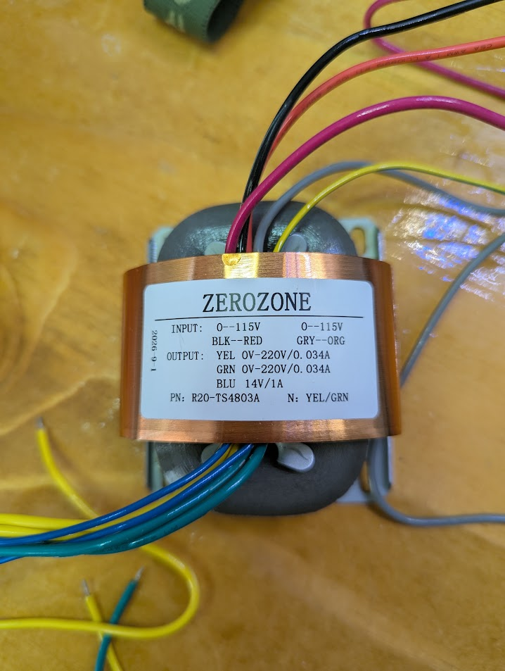

[← GG-PSU index](./README.md) · [Project](../README.md)

# Zero Zone R-core transformer — R20-TS4803A

Kit transformer for **GG-PSU** (+ **GG-PRE** load). Label photo **C** (user, 2026-11-09).



| | |
|---|---|
| **Brand** | ZEROZONE |
| **P/N** | **R20-TS4803A** |
| **Label note** | `N: YEL/GRN` |
| **Date on label** | 2026-9-1 (as printed) |

---

## Windings (from label)

| Winding | Wires | Rating |
|---------|-------|--------|
| Primary A | **BLK** — **RED** | **0–115 V** |
| Primary B | **GRY** — **ORG** | **0–115 V** |
| Secondary HV A | **YEL** | **0–220 V**, **0.034 A** |
| Secondary HV B | **GRN** | **0–220 V**, **0.034 A** |
| Secondary LV | **BLU** | **14 V**, **1 A** |

**C** = label text. GG-PSU **HV-IN** pin order **U** — buzz or match seller diagram before first power.

---

## Mains input wiring

Dual **115 V** primaries — **series** for **~230 V** EU mains (**e.g. Netherlands 230 V / 50 Hz** **C**), **parallel** for **~115 V** US mains. Frequency **50 Hz vs 60 Hz** does not change primary strapping on this R-core; use **250 VAC**-rated fuse and inlet.

### 230 V (EU / NL) **C** (user + standard R-core practice)

Two **115 V** halves in **series** (~230 V):

```
   Mains L ────── BLK
                    ├── winding A (115 V)
                 RED ─┬─ GRY
                        ├── winding B (115 V)
   Mains N ────── ORG
```

**Junction:** tie **RED** to **GRY** (you remembered this correctly).

- **Do not** use the transformer until **RED–GRY** is the only series junction (no BLK/ORG crossed).
- Use a **fuse** in **L** only: **200 mA**, **time-delay (T)**, **≥ 250 VAC**, **5×20 mm** for **230 V** series primary **I** (see [BUILD.md §1.0](../BUILD.md)). **Fast (F)** types often nuisance-trip on R-core inrush.

### 115 V (US)

**Parallel** both halves for **115 V**:

| Tie together | Role |
|--------------|------|
| **BLK** + **GRY** | One mains side |
| **RED** + **ORG** | Other mains side |

---

## Outputs → GG-PSU **I**

| Transformer | GG-PSU destination **I** |
|-------------|---------------------------|
| **YEL** + **GRN** (each **220 VAC** winding) | **HV-IN** / bridge **BR1** and **BR2** AC inputs (one winding per HV channel) |
| **BLU** (**14 VAC**, **1 A**) | Filament AC in → **BR3** → **LT1085** → **+12** to GG-PRE |

Label **`N: YEL/GRN`**: treat as manufacturer note that the **two HV secondaries** are the paired **220 V** outputs (not chassis neutral). **Common reference** is established on **GG-PSU** when strapping **±200 V** for the preamp — do not assume YEL/GRN centre-tap without a buzz test **U**.

**Filament:** **14 V** AC on **BLU** fits seller guidance (**~14–15 VAC** in for **12.6 V** DC out). Adjust with **VR1 (W202)** on the PSU.

---

## Quick system chain

```
230 V mains ──► R20-TS4803A ──► GG-PSU ──► GG-PRE AMP
              (RED–GRY tie)     ±200 V      audio I/O
                                +12 V heaters
```

---

## Chassis earth (user build **C**)

Some R-core units bring out **geel-groen** for core / shield bond. Tie **trafo geel-groen** and **IEC PE** to the **same** chassis safety-earth point (not through the DPST). Audio **star ground** is wired separately later — see [BUILD.md §1.0](../BUILD.md) as-built inlet.

## Safety

- **Mains-voltage** wiring on the primary — strain relief, fuse, correct series/parallel.
- **220 VAC** secondaries are **high voltage** — insulated terminations before bench tests.
- Bleed **GG-PSU** capacitors before probing. **±200 V** at preamp is lethal.

---

[← GG-PSU index](./README.md) · [Project](../README.md)
